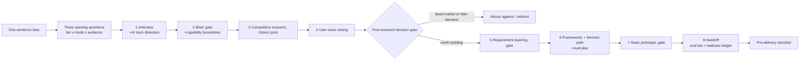

[中文](README.md) | **English**

<div align="center">

# Vibe Helper

**From a one-sentence product idea to a development-ready delivery package**

An agent skill suite for product managers and vibe coders · Bilingual, Chinese and English

[]()
[]()
[]()
[]()
[](https://star-history.com/#3091485956-png/Vibe_helper&Date)

</div>

---

Hand the agent one sentence: "I want to build a product called X." Vibe Helper walks you structurally through **requirement interview → product brief → competitive research → user voice → requirement layering → product and tech framework → static prototype → handoff**, stops at hard gates for your confirmation, and is willing to tell you "don't build this" once the research says so.

**The destination is a delivery package**: a full document set, high-fidelity clickable prototypes, and Gherkin acceptance criteria, ready to hand to developers or a downstream skill. Not a demo that gets screenshotted once and abandoned.

**Bilingual by design**: interview questions, document bodies, prototype copy and handoff notes follow your language, Chinese or English. Numbered file names and template section headings stay stable, so the bundled machine validator works in either language.

**Building an AI product?** One question in the interview, "what is left if you remove the AI", switches the run into the **AI track**: the brief commits to **capability boundaries** covering scope, quality bar and non-guarantees; Stage 6 produces the **eval plan**, built on the rule that AI designs the exam structure while humans provide the answers; the handoff package leaves a **badcase ledger** with a reproduce, attribute, fix, and backfill loop.

**Prefer not to judge every decision yourself?** Pick **delegated mode** at the start: gates become decision receipts, at most five items in plain language, each vetoable; every trade-off the agent makes on your behalf is marked `[B/C·代定]` for traceability. Whether to build at all, however, is always your call to make out loud.

## The suite: one orchestrator plus five focused skills

| Skill | What it does | Command | Trigger example |
| --- | --- | --- | --- |
| **Vibe_helper** | The 8-stage end-to-end pipeline | `/vibe` | "Help me build a product from scratch" |
| **product-brief** | Mom Test interview, product brief, AI-track detection | `/vibe-brief` | "Turn this idea into a document" |
| **competitive-analysis** | Competitive and open-source research, benchmark selection, eval seeds | `/vibe-competitive` | "Has anyone built this before" |
| **user-voice** | User voice mining, demand-realness verdict | `/vibe-voice` | "Is this demand real" |
| **requirements-layering** | MoSCoW, Gherkin acceptance, RICE | `/vibe-req` | "Layer my MVP and write acceptance criteria" |
| **tech-framework** | Thinnest path, frameworks, eval plan | `/vibe-tech` | "Pick the tech stack and design the architecture" |

The pipeline and the focused skills read and write **the same numbered files**: you can start with the pipeline and branch out, or feed single-skill output back into a full run. Each skill folder is self-contained and works when copied alone.

## What it cures

Ten common failure modes of new products and vibe coding, each with a countermeasure. Every M number maps to a mechanism in SKILL.md:

| Failure mode | Countermeasure |
| --- | --- |
| **M1** Start coding from one sentence; the result is not what was wanted | Interview plus brief, gated by explicit confirmation |
| **M2** Requirements live only in someone's head; understanding never verified | Brief confirmation gate, at most 3 revision rounds |
| **M3** Demo screenshot then abandonment; empty states, errors, keys, deployment all missing | Delivery checklist plus machine validation script |
| **M4** MVP keeps growing; mid-project features break old code | Scope guard: new ideas go to `backlog.md`, always |
| **M5** Building something nobody wants | Post-research decision gate: argue against building, with evidence |
| **M6** UI first, data model last; everything reworked | Thinnest end-to-end path plus strict dependency order |
| **M7** Documents pile up, key points drown, documents quietly contradict | Rolling status card, document version chain, consistency review |
| **M8** AI features force-fitted into Gherkin, or the eval set is graded by the same AI that wrote it | Eval plan: AI designs the exam structure, humans provide answers; the full set must pass the bar before delivery |
| **M9** Badcases fixed without attribution; each fix breaks something else | Badcase ledger: reproduce, attribute, fix, backfill into the eval set; no closure without backfill |
| **M10** "You decide" treated as a blank check; delegation without receipts or records | Three obligations: decision receipts, the kill-gate exception, [B/C·代定] traceability |

## Core mechanisms

- **Four confirmation gates**: brief, requirement scope, static prototype, delivery checklist. A wrong direction wastes everything after it, and the agent may not skip a gate
- **Willing to say "don't build it"**: three or more mature free competitors already covering the need, zero public discussion, or a dependency that cannot run. State it with evidence; the kill gate does not accept silent delegation
- **You pick the benchmarks**: after research you get the list, the recommended two or three with reasons, and the final confirmed set becomes the anchor for every later stage
- **Three opening questions**: depth tier, quick, standard or deep × decision mode, self-directed or delegated × output audience, downstream agents or human readers. **Tiers control weight, roles control shape, honesty applies to everyone**
- **Delegated mode**: gates become decision receipts, at most five plain-language items, each vetoable; the brief gate asks two plain questions; delegated decisions carry [B/C·代定] marks end to end
- **Mom Test interviews**: ask about past behavior, never about future intentions; the user's own research material is absorbed directly and marked [A：用户提供], meaning user-provided evidence
- **AI track**: interview detection → capability boundaries in the brief → acceptance rework in stage 5, quality pinned to eval references → the eval plan in stage 6, humans provide answers → boundary copy made visible in the prototype → ledger at handoff. **Boundaries are measured, not written**
- **Evidence grading and hallucination surfacing**: hallucination cannot reach zero, so the goal is mitigation plus visibility. Claims are marked **A** for direct evidence, **B** for evidence plus a reasoning chain, **C** for model conjecture; C claims stay under one third and all enter the to-verify list with a verification path; recommendations resting on C-level claims must say so; before writing to disk, five random A-level links get re-opened for spot checks
- **Dual reading mode**: the first screen of every document is a **decision panel**, at most three pending judgments, key findings, and the to-verify list, a 30-second read; the body stays comprehensive as raw material for a 30-minute verification pass
- **Gherkin acceptance plus RICE**: every Must carries at least two Given/When/Then scenarios including a non-happy path; AI Must quality acceptance points at the eval plan
- **Status card and version chain**: `00-状态.md`, the status card, is born after the interview and refreshed at every gate; later stages treat it as the primary context; the assembly manifest is cross-checked against document versions to detect staleness automatically
- **Mid-run entry**: existing outputs are reused; arrive with a finished brief and start directly from competitive research

## Install

**Claude Code, plugin marketplace, recommended**

```
/plugin marketplace add 3091485956-png/Vibe_helper
/plugin install vibe-helper@vibe-helper
```

**ZCode and others, install script, targets `~/.agents/skills/`**

```bash
git clone https://github.com/3091485956-png/Vibe_helper.git
cd Vibe_helper && bash scripts/install.sh
```

**Manual**: copy any skill folder from `skills/` into your skills directory; slash commands are optional via `bash scripts/install.sh --commands`

Once installed the skills trigger from natural language in Chinese or English; ZCode also supports direct calls like `/Vibe_helper` and `/competitive-analysis`.

## Workflow



Every project produces a complete delivery set:

```
./your-product-name/
├── 00-状态.md          # Rolling status card: primary context, consistency anchor, first handoff item
├── 01-问卷.md          # Raw interview answers, Mom Test discipline plus AI-track detection
├── 02-brief.md         # Product brief: positioning, users, pain, boundaries, capability limits; decision panel on screen one
├── 03-竞品分析.md      # Competitor list, confirmed benchmark set, eval seeds
├── 04-用户声音.md      # Opportunities, values, gaps, demand-realness verdict, eval seeds
├── 05-需求分层.md      # MoSCoW, Gherkin scenarios with eval references for AI Musts, RICE
├── 06-产品框架.md      # Information architecture, user flows, page list
├── 07-技术框架.md      # Thinnest path, stack rationale, build order
├── 08-评测方案.md      # AI track: eval set with human answers, rubric draft, pass bars, smoke subset
├── prototypes/         # High-fidelity clickable static HTML, boundary copy included for AI products
├── backlog.md          # Every mid-run idea lands here
└── badcase台账.md      # AI track: record format, attribution triage, backfill rules
```

Note for English users: file names and section headings of the generated documents keep the Chinese template forms, because they are the machine-checkable contract used by `validate.sh`; document bodies, tables and prototype copy are written in English.

## Command line

Seven slash commands: `/vibe` `/vibe-brief` `/vibe-competitive` `/vibe-voice` `/vibe-req` `/vibe-tech` `/vibe-check`, plus `vh.sh`, a **terminal helper that works without an agent**:

```bash
$ bash scripts/vh.sh new 记账App
已创建 记账App/，含 prototypes/ 与 backlog.md

$ bash scripts/vh.sh next 记账App
  01-问卷.md        done      Stage 1 需求访谈
  02-brief.md       pending   Stage 2 产品 Brief
  ...
→ 下一步: Stage 2 产品 Brief，文件 02-brief.md
  用 skill product-brief 或命令 /vibe-brief 触发

$ bash scripts/vh.sh backlog 记账App "想加导出Excel"
已记入 记账App/backlog.md
范围守卫：新想法不进本期，二期再议

$ bash scripts/vh.sh check 记账App --expect 交付包   # pre-delivery machine check
```

The repo also ships `scripts/lint-skills.sh`, a structural self-check for the suite covering frontmatter, dead reference links, shared-file drift, trigger-word boundaries, M numbering, and command files. Run it after editing a shared template to prevent drift.

## Maintainer self-tests, since v0.4

SKILL.md is a prompt program; every edit is a release, so the suite carries its own eval set. `tests/golden-scenarios.md` holds **eight golden scenarios**: adversarial personas for M1 through M10, plus the kill gate, mid-run entry, a full delegated run, and a human-reader PM pass; assertions are written as observable behavior, and since v0.5 they include bilingual regression checks. The **three-scenario smoke subset**, happy path, kill advice, and mid-run entry, runs after every SKILL.md edit; the suite's own badcase ledger sits at the end of that file, one backfill per fix.

## Changelog

<details open>
<summary><b>v0.5.0, 2026-11 · Bilingual support and prose normalization</b>, click to collapse</summary>

- **Bilingual**: all six skills carry Chinese plus English descriptions and triggers, with a language rule in each body: interview questions, document bodies, prototype copy and handoff notes follow the user's language; numbered file names and template headings stay stable so validate.sh keeps working; full English README added and cross-linked with the Chinese one; commands, plugin manifests and tests updated in both languages; golden scenarios gained bilingual assertions; the lint description ceiling rose to 900 characters
- **Prose normalization**: emojis removed from all documents and script messages; gate and choice-point markers are now words; the version header lost its decorative symbol; Chinese em-dashes and full-width parentheses removed, asides rewritten as plain statements; good and bad examples use text labels; overall tone tightened to professional writing
- **Fully behavior-compatible**: stage structure, the M1 to M10 mechanisms, the file contract, section names, and validate.sh assertion logic are unchanged; existing project packages continue to run

</details>

<details open>
<summary><b>v0.4.0, 2026-11 · AI track, evidence grading, decision panels, decision modes</b>, click to collapse</summary>

- **AI track, a conditional branch with no new gates**: interview group 8 asks what remains without AI → the brief gains **capability boundaries**, scope, quality bar, non-guarantees → research reports mark **eval seeds**, competitor weaknesses and real user inputs as future adversarial and trunk cases → stage 5 acceptance rework, AI Must quality pinned to eval references while Gherkin retreats to the engineering path → new deliverable **08-评测方案.md**, AI designs the exam structure and humans provide answers: the expected-output column is filled and approved by humans; rubric drafts are all C-level; tier sizes roughly 10, 30 to 50, and 100+; a smoke subset is mandatory → boundary copy rendered in the prototype → **badcase台账.md** at handoff, five attribution layers and backfill rules, no closure without backfill
- **Evidence grading and hallucination surfacing**, formerly the zero-hallucination discipline: hallucination cannot reach zero, so the goal is **mitigation plus visibility**; concealing a guess is the violation, not making one. Claims marked A for evidence, B for evidence plus a reasoning chain with a missing chain counting as C, C for model conjecture; C stays under one third and all enter the **to-verify list** with verification paths; the **confidence-laundering ban** requires disclosure when a recommendation rests on C-level claims; five random A-level links re-opened before writing to disk
- **Dual reading mode**: every numbered document opens with a **decision panel**, at most three pending judgments, key findings, the to-verify list; restraint governs the judgment layer, completeness governs the evidence layer, turning documents from finished products into briefings
- **User typing via three opening questions**, tier × mode × audience: **delegated mode** with three obligations, decision receipts of at most five plain items, the kill gate refusing silence, [B/C·代定] marks end to end plus two plain questions at the brief gate; **audience split**, machine contracts for downstream agents versus human-readable handoff with to-verify transfer; the iron rule: tiers control weight, roles control shape, **honesty applies to everyone**
- **Failure table extended to M10**: M8 hollow AI acceptance or self-graded exams, M9 fixing badcases without attribution, M10 treating "you decide" as a blank check
- **validate.sh upgrades**: AI-track assertions covering the 08 structure, pass bars, the ledger; first-screen decision panel checks; to-verify lists; capability boundaries; delegation records
- **Self-proof assets**: eight golden scenarios, a three-case smoke subset, and the suite's own badcase ledger in `tests/golden-scenarios.md`, applying the product's own health regime to itself
- **Stranger back-translation check for briefs**: a fresh session reads only the brief and retells it; deviations mark ambiguity; in delegated mode it becomes the two plain questions

</details>

<details>
<summary><b>v0.3.1, 2026-10 · Status card and version chain, M7</b>, click to expand</summary>

- **Rolling status card `00-状态.md`**: born after the interview as v1 with user confirmation → v2 at brief confirmation → v3 at the research assembly → v4 at scope confirmation with stable Must IDs → v5 at prototype confirmation; later stages treat it as the primary context and look up details by section instead of rereading; it ships first at handoff
- **Document version chain**: every numbered document carries a version header with version, date and change; edits bump the version; the card's assembly manifest cross-checks against current document versions, and validate.sh detects staleness automatically
- **Consistency review**: a model-layer checklist at three moments, assembly, pre-prototype, pre-handoff, plus script checks for version headers, manifest staleness, and M-F ID agreement between stages 05 and 00
- **Stable feature IDs**, M-F1 onward, assigned when 05 is first written; stages 05, 06 and 07 always cite features by ID

</details>

<details>
<summary><b>v0.3, 2026-10 · Suite split and command-line support</b>, click to expand</summary>

- **Split into one plus five**: an orchestrator plus five focused skills over one shared file contract, usable individually or as a pipeline
- **Command line**: seven Claude Code slash commands plus the agent-free terminal helper `vh.sh` with new, next, check and backlog
- **Three depth tiers**: quick, standard and deep, scaling competitor counts, channels, scenario counts and prototype pages
- **Mid-run entry**: existing outputs are reused; start from the first missing stage
- **Mom Test discipline**: ask about past behavior, not future intention
- **Gherkin acceptance plus RICE ranking**: every Must is testable scenario by scenario, with evidence-based internal ordering
- **references overhaul**: good and bad examples per template; Common Pitfalls as its own section; M1 to M6 reference links repaired
- **Engineering**: Claude Code plugin manifests, one-command install.sh, lint-skills.sh self-check, validate.sh with Gherkin scenario counting

</details>

<details>
<summary><b>v0.2, 2026-10</b>, click to expand</summary>

- Benchmark choice point: the user confirms the benchmark set after competitive research
- Zero-hallucination and anti-self-congratulation discipline: evidence grading, link and data discipline, a mandatory blind-spot section
- validate.sh machine checks; explain why at every step; boundary clarification, no final product code is generated directly

</details>

<details>
<summary><b>v0.1</b>, initial release</summary>

Eight-stage flow, four confirmation gates, the thinnest path, scope guard, delivery checklist

</details>

---

## License

[MIT](LICENSE) · Research stages need an agent with web or browser access · The build stage hands off to whatever site or full-stack skill exists in the environment; stages 1 through 7 work without one

## Star History

[](https://star-history.com/#3091485956-png/Vibe_helper&Date)
