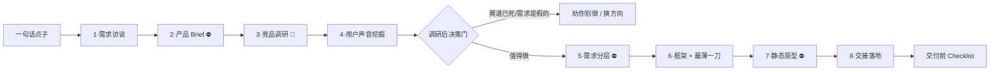

# Vibe Helper

> 从"一句话产品想法"到"一整套可直接开工的交付物"——面向产品经理(和想自己做个产品的 vibe coder)的产品雏形助手(Agent Skill)。

你只需要丢给 agent 一句话点子,Vibe Helper 会带你结构化走完:**需求访谈 → 产品 Brief → 竞品调研 → 用户声音挖掘 → 需求分层 → 产品/技术框架 → 静态原型确认 → 交接落地**,全程在关键节点停下等你确认,并在调研后敢劝你"别做了"。

**本 skill 的终点是交付包(全套文档 + 高保真可点原型 + 验收标准),不直接生成最终产品代码**——Stage 8 把材料交接给下游建站/全栈 skill 或你的开发团队。

## 它解决什么问题

PM 做新产品和 vibe coding 有几种高度重合的死法,这个 skill 逐条对症:

| 常见死法 | Vibe Helper 的对策 |
| --- | --- |
| 一句话直接开写,做出来根本不是想要的 | 先问卷访谈 + 产品 Brief,⛔ 确认后才动 |
| 做到一半发现竞品早就免费覆盖了这个需求 | 动手前先做 GitHub + 全网竞品调研 |
| 需求只存在于自己脑子里,公开渠道零讨论 | 挖竞品差评和目标用户真实帖子,假的直接劝退 |
| MVP 越做越大,第二周开始加支付/通知,第一周的代码全被改坏 | MoSCoW 分层 + 范围守卫:新想法一律进 backlog |
| 视觉返工,写完代码才发现"我要的不是这样" | 先画高保真静态原型,⛔ 点过确认再写真代码 |
| demo 一晒就扔:空状态、报错、密钥、部署全没有 | 交付前必过 checklist,验收标准逐条打勾 |

## 工作流程



标 ⛔ 的节点必须停下等用户明确确认,agent 不得自行跳过;标 🔶 的选择点必须摆出选项、推荐与理由,由用户一句话拍板(认可/增删/"你定")。

**八个阶段与产出物:**

| 阶段 | 做什么 | 产出 |
| --- | --- | --- |
| 1 · 需求访谈 | 结构化问卷补齐产品背景,模糊处追问 1–2 轮 | `01-问卷.md` |
| 2 · 提示词打磨 ⛔ | 重写成陌生工程师也能看懂的产品 Brief | `02-brief.md` |
| 3 · 竞品与开源调研 🔶 | GitHub 多关键词交叉 + Product Hunt 等,看 top 10–20;汇报参照名单+重点对标推荐,用户拍板 | `03-竞品分析.md`(含确认对标集合) |
| 4 · 用户声音挖掘 | 竞品差评/好评 + Reddit/HN/知乎/V2EX 真实讨论 | `04-用户声音.md` |
| — · 决策门 | 赛道已死 / 需求是假的 / 技术不可行 → 拿证据劝退 | 明确建议 |
| 5 · 需求分层 ⛔ | MoSCoW 切 MVP/二期/远期,每条 Must 带 ≥2 条可测验收标准 | `05-需求分层.md` |
| 6 · 框架输出 | 先写"最薄一刀"端到端路径,再展开产品框架与技术选型 | `06-产品框架.md` `07-技术框架.md` |
| 7 · 静态原型 ⛔ | 高保真可点击静态 HTML,浏览器里点一遍再确认 | `prototypes/` |
| 8 · 交接落地 | 把交付包交给下游 skill 或开发团队;范围守卫 + 交付 checklist 逐条打勾 | 交接指令 + 验收对照表 |

## 核心机制

- **四个强制确认门(⛔)**:Brief、需求范围、静态原型、交付 checklist——产品方向错了,后面全白做。
- **敢说"别做了"**:调研发现 3 个以上成熟免费竞品覆盖了需求、或公开渠道零讨论、或关键技术跑不通,就明说并给证据,不陪用户硬做一个注定没人用的东西。
- **对标由用户拍板(🔶)**:竞品调研不止交报告——汇报实际参照了哪些竞品、推荐重点对标哪 2–3 个及理由、哪些不推荐及原因;用户增删确认后,这个集合成为 Stage 4–6 评论挖掘、功能对比、差异化定位的锚。
- **零幻觉/反自嗨纪律**:事实论断一律标注 [实证]/[推断]/[假设];链接必须本轮真实打开过,数字不许凭记忆,查不到就明说"本轮未获取";每份调研文档末尾强制写"本轮盲区";产出物不许自我评价。编造链接/数据/原话,该段作废重做。
- **最薄一刀**:一句话说清"一个用户做一件最小的事,从打开到看到结果",这是最先打通的端到端路径;写不出它 = 还没想清楚 MVP。
- **验收驱动**:每条 Must have 功能带可验证的 acceptance criteria(至少一条覆盖空/错/边界),写完代码逐条对照打勾,不是"感觉差不多"就交付。
- **范围守卫**:开发中途冒出的任何新功能一律追加进 `backlog.md` 放二期,不许直接做。
- **机器自检**:自带 `scripts/validate.sh`,⛔ 门放行与交付前由 agent 运行——文档齐全、每条 Must ≥2 条不含模糊词的验收标准、调研文档含盲区小节、原型无死链,脚本不过不算过。

## 产出目录结构

每个项目会在你的工作目录生成:

```
./你的产品名/
├── 01-问卷.md          # 访谈原始答案
├── 02-brief.md         # 产品 Brief(定位/用户/痛点/边界)
├── 03-竞品分析.md      # 竞品清单 + 对本产品的启发
├── 04-用户声音.md      # 机会点/价值点/空白点(附出处链接)
├── 05-需求分层.md      # MoSCoW + 验收标准
├── 06-产品框架.md      # 信息架构/用户流程/页面清单
├── 07-技术框架.md      # 选型理由/难点解法/开发顺序
├── prototypes/         # 高保真可点击静态原型(入口 index.html)
└── backlog.md          # 中途冒出的新想法,全部丢这里
```

## 怎么用

这是一个 [Agent Skill](https://agentskills.io)(SKILL.md 格式),装到你的 coding agent 里即可。以 ZCode / Claude Code 类 agent 为例:

```bash
# 克隆到你的用户级技能目录
git clone https://github.com/3091485956-png/Vibe_helper.git ~/.agents/skills/Vibe_helper
```

然后对 agent 说类似这样的话,skill 会自动触发:

- "我想做一个叫 X 的产品/工具/App/网站"
- "有个 idea,帮我分析下并做出来"
- "vibe coding,帮我把这个产品从调研到开发一条龙做出来"

**注意事项:**

- **PM 推荐用法**:跑到 Stage 6/7 为止——竞品分析、用户声音、需求分层、产品框架和高保真原型就是你的调研报告 + PRD 素材,可直接进评审或交给开发;交接指令也可以直接发给开发团队。
- 全程使用中文交互。
- 调研阶段需要 agent 具备联网搜索/浏览器能力,否则竞品与用户声音环节会打折扣。
- 制作阶段会交接给环境里已有的建站/全栈类 skill;没有也不影响前面 1–7 阶段的使用。
- 你可以随时只跑前几步:比如只想要调研报告和需求分层,在任意 ⛔ 节点喊停即可,产出物都已落盘。

## 仓库结构

```
├── SKILL.md                       # skill 主指令:8 阶段完整流程
├── scripts/
│   └── validate.sh                # 交付包机器自检(文档齐全/验收标准/原型死链)
└── references/                    # 各阶段模板与规范
    ├── questionnaire.md           # 需求访谈问卷模板
    ├── prompt-refinement.md       # 产品 Brief 模板
    ├── competitive-analysis.md    # 竞品分析维度与模板
    ├── user-research.md           # 用户声音挖掘模板
    ├── requirements-layering.md   # MoSCoW 分层与验收标准写法
    ├── framework-output.md        # 产品/技术框架模板
    ├── wireframe.md               # 静态原型绘制规范
    ├── delivery-checklist.md      # 交付前必过 checklist
    └── anti-hallucination.md      # 零幻觉与反自嗨纪律(证据分级/链接与数据纪律/语气规范)
```

## 更新日志

**v0.2（2026-10）**
- 🔶 **对标选择点**:竞品调研后由用户确认对标集合——agent 给名单、重点推荐与理由,用户拍板,集合成为后续阶段的锚
- **零幻觉与反自嗨纪律**:事实论断标注 [实证/推断/假设];链接必须本轮真实打开,数字不许凭记忆;调研文档强制写"本轮盲区";产出物禁止自我评价
- **机器自检**:新增 `scripts/validate.sh`,⛔ 门放行与交付前机器校验交付包(文档齐全/Must 验收标准 ≥2 条且无模糊词/原型无死链)
- **每步先讲为什么**:每个阶段开始时说明它为什么存在、产出影响哪个决策;推荐必附理由与依据
- **边界澄清**:本 skill 产出文档与原型,不直接生成最终产品代码;Stage 8 只做交接与交付核对
- **可移植性**:移除环境专名(Browser Use/general_search/doubao-*),改为按环境能力探测调用

**v0.1** — 初始版本:8 阶段流程、四道 ⛔ 确认门、最薄一刀、范围守卫、交付 checklist

## License

MIT

## Star History

[](https://star-history.com/#3091485956-png/Vibe_helper&Date)
