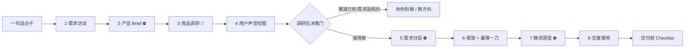

<div align="center">

# 🎯 Vibe Helper

**从「一句话产品想法」到「一整套可直接开工的交付包」**

面向产品经理与 vibe coder 的 Agent Skill 套件 · 全程中文

[]()
[]()
[]()
[]()
[](https://star-history.com/#3091485956-png/Vibe_helper&Date)

</div>

---

你只需要丢给 agent 一句话——*"我想做一个叫 X 的产品"*。Vibe Helper 会带你结构化走完 **需求访谈 → 产品 Brief → 竞品调研 → 用户声音 → 需求分层 → 产品/技术框架 → 静态原型 → 交接落地**，在关键节点停下等你确认，并在调研后敢劝你 **"别做了"**。

**它的终点是交付包**（全套文档 + 高保真可点原型 + Gherkin 验收标准），直接交给开发或下游 skill 开工——而不是 demo 一晒就扔。

## 🧩 套件组成 · 1 + 5

| | Skill | 干什么 | 直达命令 | 触发它，当用户说 |
| --- | --- | --- | --- | --- |
| 🎯 | **Vibe_helper** | 8 阶段全流程一条龙 | `/vibe` | "帮我从零开始做个产品" |
| 📝 | **product-brief** | Mom Test 问卷 + 产品 Brief | `/vibe-brief` | "帮我把这个 idea 整理成文档" |
| 🔍 | **competitive-analysis** | 竞品与开源调研 + 对标选择 | `/vibe-competitive` | "这想法有没有人做过" |
| 🗣️ | **user-voice** | 用户声音挖掘 + 需求真伪初判 | `/vibe-voice` | "这个需求是真的吗" |
| 📋 | **requirements-layering** | MoSCoW + Gherkin 验收 + RICE | `/vibe-req` | "帮我做 MVP 分层和验收标准" |
| 🏗️ | **tech-framework** | 最薄一刀 + 产品/技术框架 | `/vibe-tech` | "帮我选技术栈、设计架构" |

全流程与单点读写**同一套编号文件**：跑一半可切出，单点产出也能被全流程复用。每个 skill 文件夹自包含，单独拷走任何一个都能用。

## 🛡️ 它治什么病

PM 做新产品和 vibe coding 的六种死法，逐条对症（每个 M 编号在 SKILL.md 里有对应机制）：

| 死法 | 对策 |
| --- | --- |
| **M1** 一句话直接开写，做出来根本不是想要的 | 问卷 + Brief，⛔ 确认后才动 |
| **M2** 需求只在脑子里，理解从未被确认 | Brief 确认门，最多 3 轮修正 |
| **M3** demo 一晒就扔：空状态/报错/密钥/部署全没有 | 交付 checklist + 机器自检脚本 |
| **M4** MVP 越做越大，中途加功能改坏旧代码 | 范围守卫：新想法一律进 `backlog.md` |
| **M5** 明知没人要还硬做 | 调研后决策门：拿证据劝退 |
| **M6** 先画 UI 后定数据层，全部返工 | 最薄一刀 + 严格依赖顺序 |
| **M7** 文档越写越多，后期重点被淹没，文档间悄悄矛盾 | 滚动状态卡 + 文档版本链 + 一致性审查 |

## ✨ 核心机制

- **⛔ 四道确认门**：Brief、需求范围、静态原型、交付 checklist——方向错了后面全白做，agent 不得自行跳过
- **敢说「别做了」**：3 个以上成熟免费竞品覆盖需求 / 公开渠道零讨论 / 技术跑不通 → 拿证据明说
- **🔶 对标你拍板**：调研后给名单 + 重点推荐 + 理由，确认的集合成为后续所有阶段的锚
- **Mom Test 访谈**：问过去的真实行为（"上次遇到是什么时候、怎么解决的"），不问未来意愿（"你会用吗"）
- **Gherkin 验收标准 + RICE**：每条 Must 带 ≥2 个 Given/When/Then 场景（必含非正常路径），内部按（触达×影响×信心）/工作量排序
- **零幻觉纪律**：论断标注 [实证/推断/假设]；链接必须本轮真实打开，数字不许凭记忆；调研文档强制写"本轮盲区"；编造即整段作废
- **状态卡 + 版本链**：`00-状态.md` 从问卷后诞生、每个确认门滚动更新，后期阶段以它为主上下文（按小节回查，不全文重读）；所有文档带版本头，组装清单与文档版本交叉比对自动检测状态卡过期，交接时状态卡置顶
- **三档深度**：快速 / 标准 / 深度——周末小工具不被重流程吓跑，认真创业也能做深；⛔ 门任何档位不缩水
- **中途进入**：已有产出自动复用，拿着现成 brief 来直接从竞品调研开跑

## 🚀 安装

**Claude Code（插件市场，推荐）**

```
/plugin marketplace add 3091485956-png/Vibe_helper
/plugin install vibe-helper@vibe-helper
```

**ZCode 等（安装脚本，装到 `~/.agents/skills/`）**

```bash
git clone https://github.com/3091485956-png/Vibe_helper.git
cd Vibe_helper && bash scripts/install.sh
```

**手动**：把 `skills/` 下任意 skill 文件夹拷进你的技能目录即可；slash 命令可选装：`bash scripts/install.sh --commands`

装好后自然语言即可触发；ZCode 也支持 `/Vibe_helper`、`/competitive-analysis` 直呼。

## 📖 工作流程



每个项目都会生成一套完整交付物：

```
./你的产品名/
├── 00-状态.md          # 滚动状态卡：主上下文/一致性锚/交接首材料（带组装清单）
├── 01-问卷.md          # 访谈原始答案（Mom Test 纪律）
├── 02-brief.md         # 产品 Brief（定位/用户/痛点/边界）
├── 03-竞品分析.md      # 竞品清单 + 确认对标集合
├── 04-用户声音.md      # 机会点/价值点/空白点 + 需求真伪初判
├── 05-需求分层.md      # MoSCoW + Gherkin 验收场景 + RICE 排序
├── 06-产品框架.md      # 信息架构/用户流程/页面清单
├── 07-技术框架.md      # 最薄一刀/选型理由/开发顺序
├── prototypes/         # 高保真可点击静态原型（入口 index.html）
└── backlog.md          # 中途冒出的新想法，全部丢这里
```

## 🖥️ 命令行

7 个 slash 命令直达（`/vibe` `/vibe-brief` `/vibe-competitive` `/vibe-voice` `/vibe-req` `/vibe-tech` `/vibe-check`），外加一个**不依赖 agent 的终端助手** `vh.sh`：

```bash
$ bash scripts/vh.sh new 记账App
已创建 记账App/（含 prototypes/ 与 backlog.md）

$ bash scripts/vh.sh next 记账App
  01-问卷.md        完成    Stage 1 需求访谈
  02-brief.md       未开始  Stage 2 产品 Brief
  ...
→ 下一步: Stage 2 产品 Brief（02-brief.md）
  用 skill『product-brief』或命令『/vibe-brief』触发

$ bash scripts/vh.sh backlog 记账App "想加导出Excel"
已记入 记账App/backlog.md（范围守卫：新想法不进本期，二期再议）

$ bash scripts/vh.sh check 记账App --expect 交付包   # 交付前机器自检
```

仓库还带 `scripts/lint-skills.sh`：对套件自身做 56 项体检（frontmatter / 引用死链 / 共享文件漂移 / 触发词划界 / M 编号 / 命令文件），改完共享模板跑一遍即可防漂移。

## 📜 更新日志

<details open>
<summary><b>v0.3.1（2026-10）· 状态卡 + 版本链（M7）</b> —— 点击收起</summary>

- **滚动状态卡 `00-状态.md`**：问卷后即诞生（v1 问卷纪要 ⛔ 用户确认）→ Brief 确认 v2 → 调研主组装 v3 → 范围确认 v4（Must 带稳定 ID）→ 原型确认 v5；后期阶段以它为主上下文，按小节回查而非全文重读，交接时置顶
- **文档版本链**：所有编号文档带版本头（📌 版本 vN · 日期 · 变更），修改即 bump；状态卡组装清单（doc@vN）与文档当前版本交叉比对，validate.sh 自动检测过期
- **一致性审查**：模型层 checklist（组装时 / 原型确认前 / 交接前三个时点）+ 脚本层（版本头存在性、组装清单过期、05 功能 ID 与 00 Must ID 集合一致）
- **稳定功能 ID**（M-F1…）首次写 05 时分配，05/06/07 引用功能一律带 ID

</details>

<details>
<summary><b>v0.3（2026-10）· 套件化 + 命令行适配</b> —— 点击展开</summary>

- **拆分为 1+5 套件**：全流程 orchestrator + 5 个单点 skill，同一套文件契约，可单点使用也可全流程
- **命令行适配**：7 个 Claude Code slash 命令 + 纯终端助手 `vh.sh`（new / next / check / backlog）
- **三档深度**：快速/标准/深度，竞品数、渠道数、验收场景数、原型页数随档伸缩
- **中途进入**：已有产出直接复用，从缺失阶段开始
- **Mom Test 访谈纪律**：问过去的行为，不问未来的意愿
- **Gherkin 验收标准 + RICE 排序**：Must 逐场景可测，内部排序有依据
- **references 全面升级**：每份模板增加好/坏对照示例；Common Pitfalls 独立成节；修复 M1–M6 编号断链
- **工程化**：Claude Code 插件清单、install.sh 一键安装、lint-skills.sh 自检、validate.sh 支持 Gherkin 场景计数

</details>

<details>
<summary><b>v0.2（2026-10）</b> —— 点击展开</summary>

- 🔶 对标选择点：竞品调研后由用户确认对标集合
- 零幻觉与反自嗨纪律：证据分级 / 链接与数据纪律 / 强制盲区小节
- validate.sh 机器自检；每步先讲为什么；边界澄清（不直接生成最终产品代码）

</details>

<details>
<summary><b>v0.1</b> —— 初始版本</summary>

8 阶段流程、四道 ⛔ 确认门、最薄一刀、范围守卫、交付 checklist

</details>

---

## License

[MIT](LICENSE) · 调研类 skill 需要 agent 具备联网/浏览器能力 · 制作阶段交接给环境里已有的建站/全栈 skill，没有也不影响 1–7 阶段使用

## ⭐ Star History

[](https://star-history.com/#3091485956-png/Vibe_helper&Date)
