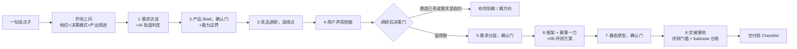

**中文** | [English](README.en.md)

<div align="center">

# Vibe Helper

**从一句话产品想法，到一整套可直接开工的交付包**

面向产品经理与 vibe coder 的 Agent Skill 套件 · 中英双语

[]()
[]()
[]()
[]()
[](https://star-history.com/#3091485956-png/Vibe_helper&Date)

</div>

---

你只需要丢给 agent 一句话："我想做一个叫 X 的产品"。Vibe Helper 会带你结构化走完 **需求访谈 → 产品 Brief → 竞品调研 → 用户声音 → 需求分层 → 产品与技术框架 → 静态原型 → 交接落地**，在关键节点停下等你确认，并在调研后敢劝你"别做了"。

**它的终点是交付包**：全套文档、高保真可点原型、Gherkin 验收标准，直接交给开发或下游 skill 开工，而不是 demo 一晒就扔。

**中英双语**：访谈提问、全部文档正文、原型文案与交接说明自动跟随你的语言。编号文件名与模板小节标题保持稳定，机器自检不受语言影响。

**做的是 AI 产品？** 问卷里一个判定，即"把 AI 拿掉，产品还剩什么"，就会切进 **AI 轨道**：Brief 里承诺**能力边界**，含适用域、水平线、不保证；Stage 6 产出 **08-评测方案**，遵守 AI 出卷子的结构、人出答案；交接包里留下 **badcase 台账**，走复现、归因、修复、回灌的闭环。

**不想亲自判断每个决策？** 开场选 **委托模式**：门变成决策回执，≤5 件事，白话，可否决；AI 替你定的每一处都标 `[B/C·代定]` 留痕。但"做不做"永远要你亲口说。

## 套件组成，1 加 5

| Skill | 干什么 | 直达命令 | 触发它，当用户说 |
| --- | --- | --- | --- |
| **Vibe_helper** | 8 阶段全流程一条龙 | `/vibe` | "帮我从零开始做个产品" |
| **product-brief** | Mom Test 问卷、产品 Brief、AI 轨道判定 | `/vibe-brief` | "帮我把这个 idea 整理成文档" |
| **competitive-analysis** | 竞品与开源调研、对标选择、评测种子 | `/vibe-competitive` | "这想法有没有人做过" |
| **user-voice** | 用户声音挖掘、需求真伪初判 | `/vibe-voice` | "这个需求是真的吗" |
| **requirements-layering** | MoSCoW、Gherkin 验收、RICE | `/vibe-req` | "帮我做 MVP 分层和验收标准" |
| **tech-framework** | 最薄一刀、框架、08-评测方案 | `/vibe-tech` | "帮我选技术栈、设计架构" |

全流程与单点读写**同一套编号文件**：跑一半可切出，单点产出也能被全流程复用。每个 skill 文件夹自包含，单独拷走任何一个都能用。

## 它治什么病

PM 做新产品和 vibe coding 的十种死法，逐条对症。每个 M 编号在 SKILL.md 里有对应机制：

| 死法 | 对策 |
| --- | --- |
| **M1** 一句话直接开写，做出来根本不是想要的 | 问卷加 Brief，过确认门后才动 |
| **M2** 需求只在脑子里，理解从未被确认 | 隐式决策清单分轮拷问加 Brief 确认门，最多 3 轮修正 |
| **M3** demo 一晒就扔，空状态、报错、密钥、部署全没有 | 交付 checklist 加机器自检脚本 |
| **M4** MVP 越做越大，中途加功能改坏旧代码 | 范围守卫：新想法一律进 `backlog.md` |
| **M5** 明知没人要还硬做 | 调研后决策门：拿证据劝退 |
| **M6** 先画 UI 后定数据层，全部返工 | 最薄一刀加严格依赖顺序 |
| **M7** 文档越写越多，后期重点被淹没，文档间悄悄矛盾 | 滚动状态卡、文档版本链、一致性审查 |
| **M8** AI 功能拿 Gherkin 硬验收非确定输出，或评测集自出卷自判卷 | 08-评测方案：AI 出卷子的结构、人出答案；评测集整集达线才算交付 |
| **M9** badcase 不归因直接乱修，修一个坏一个 | badcase 台账：复现、归因、修复、回灌评测集，未回灌不得关闭 |
| **M10** 把"你定"当免检，委托无回执无留痕 | 委托三义务：决策回执、劝退门例外、[B/C·代定] 留痕 |

## 核心机制

- **四道确认门**：Brief、需求范围、静态原型、交付 checklist。方向错了后面全白做，agent 不得自行跳过
- **敢说"别做了"**：3 个以上成熟免费竞品覆盖需求、公开渠道零讨论、技术跑不通，拿证据明说；劝退门不接受委托沉默
- **对标你拍板**：调研后给名单、重点推荐加理由；确认的集合成为后续所有阶段的锚
- **开场三问**：深度档位，快速、标准或深度 × 决策模式，自主或委托 × 产出用途，喂 agent 或给人读。**档位管轻重，角色管形态，诚实机制谁都不豁免**
- **委托模式**：门变决策回执，≤5 项，白话，可否决；Brief 门答 2 道白话题；代定决策标 [B/C·代定] 全程留痕
- **Mom Test 访谈**：问过去的真实行为，不问未来的意愿；提问四分纪律，行为题禁附推荐、决策题必附推荐加理由、事实题不问用户即标待调研、谈论解决不了的标原型期验证；用户自有材料按 [A：用户提供] 直接吸收
- **隐式决策清单**：Brief 门先拷问 agent 替你做的每个决定，每条带选择、理由、依据等级，一轮至多 8 条且同轮互不依赖，逐条认否改；一条都不否会先警告再放行，清单清零后才过 Brief 全文
- **金标准报告骨架**：03 竞品分析每竞品统一五维，加横向对比表、生态位地图与三分法结论即值得模仿、可优化、非必要可延后；04 用户声音痛点按严重程度编号，每条带定性标题、原话引述、量化数据、行为证据与去向，另产现有工具缺口表；05 标准档起先写需求地图即用户成熟度、旅程阶段、KANO，再落 MoSCoW。**骨架不分档，快速档砍深度不砍结构**；范例对照 skills/Vibe_helper/references/report-examples/
- **AI 轨道**：问卷判定 → Brief 能力边界 → 05 验收改造，质量挂评测引用 → 08-评测方案，人出答案 → 原型边界可视化 → 台账交接。**边界不是写出来的，是测出来的**
- **证据分级与幻觉显性化**：幻觉不可能为零，目标是缓解加显性化。论断标 **A** 有证据、**B** 证据加推理链、**C** 模型推测；C 级 ≤1/3 且全部进"待核实清单"附验证路径；推荐依赖 C 级必须声明，即信心洗白禁令；落盘前随机抽 5 个 A 级链接溯源复核
- **文档双阅读模式**：每份文档第一屏是**决策面板**，含待你判断的事 ≤3、关键发现、待核实清单，30 秒拍板；正文大而全给核实留原料，30 分钟核实
- **Gherkin 验收加 RICE**：每条 Must 带 ≥2 个 Given/When/Then 场景，必含非正常路径；AI 类 Must 质量验收挂 08 评测引用
- **状态卡加版本链**：`00-状态.md` 从问卷后诞生、每个确认门滚动更新，后期以它为主上下文；组装清单与文档版本交叉比对自动检测过期
- **中途进入**：已有产出自动复用，拿着现成 brief 来直接从竞品调研开跑

## 安装

**Claude Code，插件市场，推荐**

```
/plugin marketplace add 3091485956-png/Vibe_helper
/plugin install vibe-helper@vibe-helper
```

**ZCode 等，安装脚本，装到 `~/.agents/skills/`**

```bash
git clone https://github.com/3091485956-png/Vibe_helper.git
cd Vibe_helper && bash scripts/install.sh
```

**手动**：把 `skills/` 下任意 skill 文件夹拷进你的技能目录即可；slash 命令可选装：`bash scripts/install.sh --commands`

装好后自然语言即可触发，中英文都行；ZCode 也支持 `/Vibe_helper`、`/competitive-analysis` 直呼。

## 工作流程



每个项目都会生成一套完整交付物：

```
./你的产品名/
├── 00-状态.md          # 滚动状态卡：主上下文、一致性锚、交接首材料，含 AI 轨道判定与决策模式
├── 01-问卷.md          # 访谈原始答案，Mom Test 纪律加 AI 轨道判定
├── 02-brief.md         # 产品 Brief：定位、用户、痛点、边界、能力边界；第一屏决策面板
├── 03-竞品分析.md      # 每竞品五维分析、横向对比与生态位地图、三分法结论、确认对标集合、评测种子
├── 04-用户声音.md      # 痛点按严重程度编号、现有工具缺口表，加需求真伪初判与评测种子
├── 05-需求分层.md      # 需求地图、MoSCoW、Gherkin 验收场景，AI 类挂评测引用，加 RICE
├── 06-产品框架.md      # 信息架构、用户流程、页面清单
├── 07-技术框架.md      # 最薄一刀、选型理由、开发顺序
├── 08-评测方案.md      # AI 轨道：评测集，人出答案，加 rubric 草案、通过线、冒烟子集
├── prototypes/         # 高保真可点击静态原型，AI 轨道含边界可视化文案
├── backlog.md          # 中途冒出的新想法，全部丢这里
└── badcase台账.md      # AI 轨道：记录格式、归因分诊表、回灌规则
```

## 命令行

7 个 slash 命令直达：`/vibe` `/vibe-brief` `/vibe-competitive` `/vibe-voice` `/vibe-req` `/vibe-tech` `/vibe-check`，外加一个**不依赖 agent 的终端助手** `vh.sh`：

```bash
$ bash scripts/vh.sh new 记账App
已创建 记账App/，含 prototypes/ 与 backlog.md

$ bash scripts/vh.sh next 记账App
  01-问卷.md        完成    Stage 1 需求访谈
  02-brief.md       未开始  Stage 2 产品 Brief
  ...
  08-评测方案.md    未开始  Stage 6 评测方案，AI 轨道
→ 下一步: Stage 2 产品 Brief，文件 02-brief.md
  用 skill product-brief 或命令 /vibe-brief 触发

$ bash scripts/vh.sh backlog 记账App "想加导出Excel"
已记入 记账App/backlog.md
范围守卫：新想法不进本期，二期再议

$ bash scripts/vh.sh check 记账App --expect 交付包   # 交付前机器自检
```

仓库还带 `scripts/lint-skills.sh`：对套件自身做结构体检，覆盖 frontmatter、引用死链、共享文件漂移、触发词划界、M 编号、命令文件。改完共享模板跑一遍即可防漂移。

## 维护者自测，v0.4 起

SKILL.md 是 prompt 程序，每次修改都是一次发版，套件自己也得有评测集。`tests/golden-scenarios.md` 收录 **8 条黄金情景**：M1 至 M10 各配对抗人格，加劝退、中途进入、委托全链、PM 人读；断言全部写成可观察行为，另含中英文双语回归断言。**冒烟子集 3 条**，即顺利路径、劝退、中途进入，在每次改 SKILL.md 后必跑；skill 自己的 badcase 台账在文件末尾，修一条回灌一条。

## 更新日志

<details open>
<summary><b>v0.6.0，2026-11 · 金标准报告约束与隐式决策清单</b>，点击收起</summary>

- **金标准报告骨架**：两份真实研究报告转为金标准范例入库 `references/report-examples/`，03 与 04 的产出对照它写。03 竞品分析重写为固定骨架：每竞品统一五维即简介、链接、技术框架、竞争优势、劣势与局限，优劣各至少 3 条完整论点；新增横向对比表、生态位地图即谁在哪层与没人覆盖的空隙在哪、三分法结论即值得模仿、可优化、**非必要可延后**（调研侧的 Won't，防调研诱发范围蔓延）、组合式定位建议与初期聚焦加远期探索分层；末尾编号数据来源列表。04 用户声音：痛点按严重程度编号排列，每条四件套即定性标题、用户原话引述、量化数据（有则必引研究编号，无则明确声明）、行为证据，且每条写明去向；证据来源扩为五类，学术实证研究列为最硬来源，标准档起必查；新增现有工具缺口表现有方案加能做什么加关键缺口，喂差异化定位与劝退门。**骨架不分档，快速档砍的是深度不是结构**
- **05 需求地图，前置视角不替代契约**：标准档起先写用户成熟度分层 L1 至 L3、旅程阶段分层（对应 04 痛点编号）、KANO 三层与 MoSCoW 的映射，深度档加三维交叉矩阵；地图是定层输入，MoSCoW、Gherkin、RICE 开发契约地位不变。Must 来源细化到痛点编号，无痛点证据支撑的功能 RICE 信心封顶 1；排序表加理由列；P0、P1、P2 仅作对外别名
- **隐式决策清单，借鉴 grill-me 的 grilling 机制**：自主模式 Brief 门分两步，先提取 agent 替用户做的隐式决策，每条一行即决策点、选择、理由、依据等级；一轮至多 8 条、同轮互不依赖，用户逐条认否改；**一条都不否必须警告**再放行；清单清零后贴全文做最终确认。委托模式的决策回执即此清单的代定版。问卷新增提问四分纪律：行为题禁附推荐、决策题必附推荐加理由、事实题不问用户即标待调研、谈论解决不了的标原型期验证
- **validate.sh 新增金标准结构检查**：03 的横向对比、非必要、数据来源与 04 的工具缺口、数据来源为 FAIL 级；生态位、定位建议、05 需求地图与痛点编号为 WARN 级。lint 冒烟与夹具测试通过，共享文件字节级一致
- **黄金情景回灌**：G1 顺利路径新增五维报告、痛点编号、隐式决策清单断言；G5 闭眼用户新增全默认放行必须警告断言；G6 快速档新增骨架不豁免断言
- **单点 skill 同步**：competitive-analysis、user-voice、requirements-layering、product-brief、tech-framework 的 references 副本与金标准范例全部同步，lint 漂移检查全过

</details>

<details open>
<summary><b>v0.5.0，2026-11 · 中英双语与行文规范化</b>，点击收起</summary>

- **中英双语**：六个 skill 的描述与触发词全部中英双语，正文新增语言规则，访谈提问、文档正文、原型文案、交接说明自动跟随用户语言；编号文件名与模板小节标题保持稳定，validate.sh 机器自检不受语言影响；README 新增完整英文版并与中文版互链；命令、插件清单、测试同步双语；黄金情景新增双语回归断言，lint 描述长度上限放宽至 900 字符
- **行文规范化**：全部文档与脚本提示去除表情符号，确认门与选择点改为文字标记，版本头去掉装饰符号；删除中文破折号与全角括号，补充语改为独立表述；好、坏对照改用文字标注；语气整体收紧为专业书面风格
- **行为完全兼容**：阶段划分、M1 至 M10 机制、文件契约、小节名、validate.sh 断言逻辑全部保持不变，旧项目交付包可直接续跑

</details>

<details open>
<summary><b>v0.4.0，2026-11 · AI 轨道、证据分级、决策面板、决策模式</b>，点击收起</summary>

- **AI 轨道，条件分支不新增确认门**：问卷第 8 组判定，即把 AI 拿掉剩什么 → Brief 新增**能力边界**，含适用域、水平线、不保证 → 调研报告标**评测种子**，竞品短板与用户真实输入即未来对抗与主干用例 → 05 验收改造，AI 类 Must 质量挂 08 评测引用，Gherkin 退守工程路径 → 新交付物 **08-评测方案.md**，AI 出卷子的结构、人出答案：期望列人填人批；rubric 草案全标 C 级；档位规模快速约 10、标准 30–50、深度 100+；必含冒烟子集 → 原型**边界可视化** → 交接留 **badcase台账.md**，归因分诊五层加回灌规则，未回灌不得关闭
- **证据分级与幻觉显性化**，原"零幻觉纪律"改名重写：承认幻觉不可能为零，目标是**缓解加显性化**。猜测不是违规，藏起来才是。论断标 A 有证据、B 证据加推理链且无链视同 C、C 模型推测；C 级 ≤1/3 且全部进**待核实清单**，合并旧"本轮盲区"，附验证路径；**信心洗白禁令**，推荐依赖 C 级必须声明；落盘前随机抽 5 个 A 级链接**溯源抽查**
- **文档双阅读模式**：所有编号文档第一屏加**决策面板**，含待你判断的事 ≤3、关键发现、待核实清单，30 秒拍板或 30 分钟核实；克制管判断层，全面管证据层，文档从"替 PM 写好的成品"变成"递给 PM 的简报"
- **用户分型：开场三问**，档位 × 决策模式 × 产出用途：**委托模式**三义务，即决策回执 ≤5 项白话可否决、劝退门不接受沉默、[B/C·代定] 全程留痕加 Brief 门改 2 道白话题回译；**产出用途分流**，喂 agent 出机器合同，给人读出人读交接加待核实移交；铁律：档位管轻重，角色管形态，**诚实机制谁都不豁免**
- **失败模式表扩至 M10**：M8 即 AI 验收形同虚设或自出卷自判卷、M9 即 badcase 无归因乱修、M10 即把"你定"当免检
- **validate.sh 升级**：AI 轨道断言含 08 结构、通过线、台账；决策面板第一屏检查；待核实清单；能力边界；委托留痕
- **自证资产**：`tests/golden-scenarios.md` 8 条黄金情景加 3 条冒烟子集加 skill 自己的 badcase 台账，把给用户产品的体检制度吃回自己身上
- **Brief 陌生人回译自检**：新会话只读 Brief 复述，偏离处即歧义处；委托模式反向应用为白话题

</details>

<details>
<summary><b>v0.3.1，2026-10 · 状态卡与版本链，M7</b>，点击展开</summary>

- **滚动状态卡 `00-状态.md`**：问卷后即诞生，v1 问卷纪要用户确认 → Brief 确认 v2 → 调研主组装 v3 → 范围确认 v4，Must 带稳定 ID → 原型确认 v5；后期阶段以它为主上下文，按小节回查而非全文重读，交接时置顶
- **文档版本链**：所有编号文档带版本头，含版本、日期、变更；修改即更新；状态卡组装清单与文档当前版本交叉比对，validate.sh 自动检测过期
- **一致性审查**：模型层 checklist，组装时、原型确认前、交接前三个时点，加脚本层，即版本头存在性、组装清单过期、05 功能 ID 与 00 Must ID 集合一致
- **稳定功能 ID**，M-F1 起，首次写 05 时分配；05/06/07 引用功能一律带 ID

</details>

<details>
<summary><b>v0.3，2026-10 · 套件化与命令行适配</b>，点击展开</summary>

- **拆分为 1 加 5 套件**：全流程 orchestrator 加 5 个单点 skill，同一套文件契约，可单点使用也可全流程
- **命令行适配**：7 个 Claude Code slash 命令，加纯终端助手 `vh.sh`，含 new、next、check、backlog
- **三档深度**：快速、标准、深度，竞品数、渠道数、验收场景数、原型页数随档伸缩
- **中途进入**：已有产出直接复用，从缺失阶段开始
- **Mom Test 访谈纪律**：问过去的行为，不问未来的意愿
- **Gherkin 验收标准加 RICE 排序**：Must 逐场景可测，内部排序有依据
- **references 全面升级**：每份模板增加好、坏对照示例；Common Pitfalls 独立成节；修复 M1 至 M6 编号断链
- **工程化**：Claude Code 插件清单、install.sh 一键安装、lint-skills.sh 自检、validate.sh 支持 Gherkin 场景计数

</details>

<details>
<summary><b>v0.2，2026-10</b>，点击展开</summary>

- 对标选择点：竞品调研后由用户确认对标集合
- 零幻觉与反自嗨纪律：证据分级、链接与数据纪律、强制盲区小节
- validate.sh 机器自检；每步先讲为什么；边界澄清，不直接生成最终产品代码

</details>

<details>
<summary><b>v0.1</b>，初始版本</summary>

8 阶段流程、四道确认门、最薄一刀、范围守卫、交付 checklist

</details>

---

## License

[MIT](LICENSE) · 调研类 skill 需要 agent 具备联网或浏览器能力 · 制作阶段交接给环境里已有的建站、全栈 skill，没有也不影响 1 至 7 阶段使用

## Star History

[](https://star-history.com/#3091485956-png/Vibe_helper&Date)
